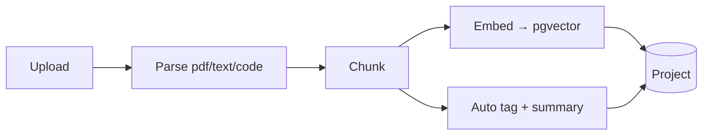

# Projects

A **project** holds the files and standing instructions behind a piece of work. Put a
conversation in a project and the agent knows what the project contains, follows its
instructions, searches and cites its documents, and keeps what it learns in the project's own
memory. (In the API and in configuration, projects are called *workspaces*.)

## Open the Projects hub

Click **Projects** in the top bar, or open the command palette (`⌘K` / `Ctrl K`) and choose
**Open Projects**. The hub lists your projects. Each one has:

- a **name** and **description**, saying what the project is about;
- **instructions**: standing guidance the agent follows in every conversation of the project,
  such as tone, goals, constraints, or what the files are;
- **files**: PDFs, text, Markdown or code you upload (click the upload area to browse), plus
  notes written by you or your agents. Each file is indexed in the background and marked ready
  once it can be searched;
- **conversations**: the chats that belong to the project. Removing one from the project keeps
  the conversation.

## Work inside a project

- **Start a new conversation in a project:** in an empty conversation, choose a project under
  **Start in a project**, below the welcome starters.
- **Attach an existing conversation:** open the
  [Relay](chat.md#the-relay--the-conversations-command-center), choose **Projects**, and pick one.

A conversation stays in its project until you remove it. Inside a project, the agent:

- **knows the project on every turn:** its name, description and file list (names, tags and short
  summaries), so it knows what it has before it searches;
- **follows the project's instructions** on every turn;
- **finds what it needs:** first the right file, then the right passage, and it can read a
  document in full. In the transcript these steps appear as `project_search`, `document_query`
  and `read_document`;
- **writes documents into the project:** notes, plans, reports, or "memory files" it keeps
  current across conversations (`create_document`, `update_document`). They're indexed like any
  upload. This is on by default, and the `workspace_agent_write_tools` setting turns it off.
  Agents write Markdown and plain text only;
- **cites** the documents it used, in the conversation's **Sources** panel;
- **remembers in the project's channel:** what it learns goes to the project's
  [memory channel](memory.md#channels--projects), and recall still draws on your global memory.

Per-file and per-project size limits apply to uploads and to agent writes.

## Agent Shells (opt-in)

Turn on **"Allow shell"** for a project and agents working in it get sandboxed shell tools —
`run_command` plus `write_file` / `read_file` / `list_files` — operating on a working copy of
the project's files. It's **off by default**: this is real command execution, so it's a
deliberate opt-in, per project.

Each project picks a **backend**:

| Backend | Isolation | Network | Installs | Needs |
|---|---|---|---|---|
| **Bubblewrap** (default) | filesystem jailed to the work dir, scrubbed env, non-root, time-limited | **off** | no | `bubblewrap` on the server |
| **Container** | a persistent per-project Docker container, clean (no host secrets), on its own bridge | **on** | yes (`pip`/`apt`/`npm`) | `shell.docker.enabled` + a Docker daemon |

Both keep the agent away from your secrets and the host: Bubblewrap can't read `data/` or
reach the network; the Container shares none of the host filesystem, so network + root *inside*
it are safe — there's nothing to exfiltrate but the project's own files.

**Container lifecycle** is visible and controllable in the hub: live memory / CPU / install
size, an idle-GC countdown, and **Start / Stop / Reset** (drop installs, keep files) / **Remove**.
Installed packages persist across commands and conversations until you reset or delete the
project.

### Deploying the container backend

The API drives Docker as a *client*. In development the API runs on the host and uses the host
Docker directly. In production (the API runs in a container) enable the **Docker-in-Docker
sidecar** overlay — the API talks to the sidecar's own daemon over authenticated TLS on the
internal network; the host's Docker socket is never mounted:

```bash
docker compose -f docker-compose.yml -f docker-compose.shell.yml --profile production up -d
# and set shell.docker.enabled = true
```

The sidecar is per-stack, so enable it only on clusters that need install-capable shells —
everywhere else the lightweight Bubblewrap backend stays free.

## Under the hood

Each uploaded file is processed in the background:



A document moves `pending → ready` (or `failed`), with live status in the hub. Storage is split
three ways: file **bytes** in a content-addressed blob store (deduplicated by sha256),
**manifest** rows in PostgreSQL, and **chunk vectors** in pgvector. Retrieval runs in two tiers:
the catalog search finds the right file by name, tag and summary, then the semantic search finds
the right passage. The legacy tool name `workspace_search` still works as an alias of
`project_search`.

## Configuration

- `shell.*` — sandbox limits shared by both backends: `timeout_seconds`, `max_output_chars`,
  `deny_patterns`, `allow_network` (bubblewrap), `max_materialize_bytes`, `workdir_cleanup_days`.
- `shell.docker.*` — container backend: `enabled`, `image` (default `python:3.14-slim`, independent
  of the API's own Python version),
  `memory`, `cpus`, `pids_limit`, `network`, `idle_ttl_days`.

See the [API reference](/docs/api/endpoints#workspaces) for the project (workspace) and
shell-container endpoints.
